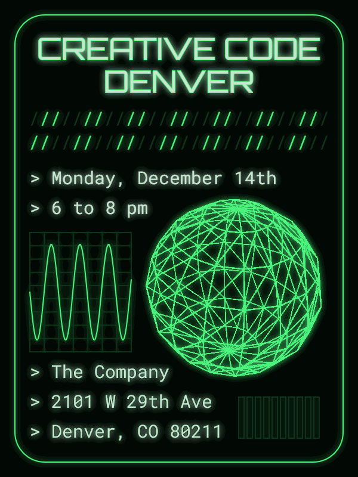
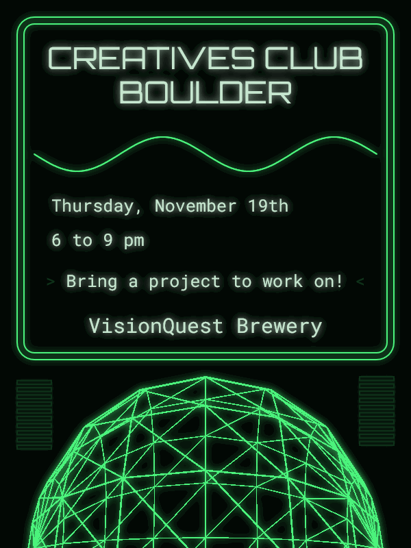
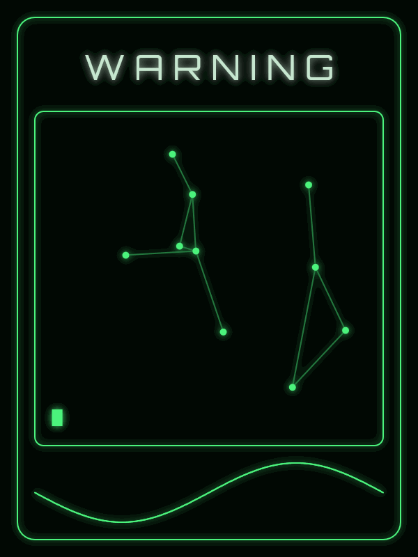

# Scifi UI

A library of [p5.js](https://p5js.org) functions for generating scifi-looking micrographics that can be combined modularly into different compositions.

## Graphics

### creative-code-2026-12-14.js



### creatives-club-boulder-2026-11-19.js



### prototype-network.js



## Installation for development
This project uses the p5 + VS Code setup as
[published by Stef Tervelde and Raphaël de Courville](https://sableraph.notion.site/The-perfect-p5-js-VSCode-setup-for-everyday-creative-coding-414c7eb4fb524da28d53763777d427b8),
which assumes that p5 will be installed using [Node.js](https://nodejs.org/en).

To install p5 to use with this template, first check that Node.js is installed:
```bash
node --version
```

If Node returns the version, make sure you have navigated to the project
directory and initialize a new Node package:
```bash
npm init -y
```

Then, download & install the p5 package:
```bash
npm install @types/p5
```
